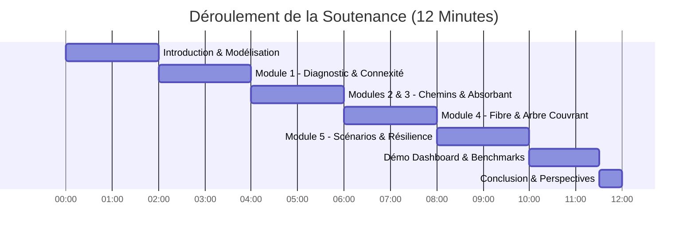

# Plan de Soutenance Orale — Novapolis Résilience (12 Minutes)

> **Projet Intégrateur Théorie des Graphes & Algorithmique (EFREI Paris - S1)**  
> **Cadre :** Projet académique conforme au cahier des charges officiel (Barème 20 points)  
> **Auteurs :** Équipe Projet Novapolis Résilience  
> **Support :** Tableau de bord Web Neubrutaliste (`http://localhost:8000`) & Notebook Jupyter (`notebook_projet.ipynb`)

---

## Répartition Chronométrique (12:00 Chrono)

---

## Minute 00:00 - 02:00 | Introduction & Modélisation (Module Préliminaire)

### Objectif
Poser le contexte urbain de crise, la problématique décisionnelle, et la rigueur d'ingénierie logicielle (zéro bibliothèque externe).

### Déroulé Oral
> *"Bonjour à tous. Face à une catastrophe naturelle ou un attentat majeur dans une métropole moderne, les services de secours (SAMU, pompiers, police) doivent agir en moins de 10 minutes, tandis que l'infrastructure de télécommunication doit maintenir la liaison critique entre les postes de commandement.*  
>  
> *Pour répondre à ce défi, nous avons développé **Novapolis Résilience**, une plateforme d'aide à la décision algorithmique intégrale, implémentée **strictement en Python standard, sans aucune bibliothèque externe de graphes telle que NetworkX**.*  
>  
> *Notre modélisation repose sur une dualité fondamentale :*
> 1. *Un **graphe orienté pondéré** pour le réseau routier, modélisant les sens uniques parisiens, les temps en heure creuse et heure de pointe, ainsi que les capacités des voies.*
> 2. *Un **graphe non-orienté pondéré** pour le réseau de fibre optique, avec coûts de déploiement en k€ et liaisons physiques symétriques.*
>  
> *Les données sont validées dès le chargement CSV (cohérence des identifiants, coordonnées GPS, sens uniques), et toute simulation s'effectue sur des **clones profonds isolés**, interdisant toute mutation parasite de l'état initial."*

### Support Visuel
* Afficher la page d'accueil du Dashboard sur `http://localhost:8000` avec la cartographie OpenStreetMap de Paris et le Campus Efrei (`SITE_111`).

---

## Minute 02:00 - 04:00 | Module 1 : Diagnostic Topologique & Accessibilité

### Objectif
Démontrer la maîtrise des parcours fondamentaux (DFS/BFS) et clarifier les 3 niveaux de connexité exigés par le sujet.

### Déroulé Oral
> *"Dans le Module 1, nous avons répondu à l'exigence d'analyse topologique exhaustive :*  
>  
> *Premièrement, nous distinguons rigoureusement trois niveaux de connexité :*  
> - *La **connexité faible** (graphe sous-jacent non orienté).*  
> - *L'**accessibilité orientée** depuis une caserne donnée ($s \rightsquigarrow v$).*  
> - *La **forte connexité** (SCC / CFC) implémentée via l'algorithme de Tarjan en $\mathcal{O}(|V| + |E|)$.*  
>  
> *Deuxièmement, la détection des cycles orientés dans le réseau routier s'appuie sur un **DFS récursif à 3 couleurs** (Blanc: non visité, Gris: en cours dans la pile d'appel, Noir: traité). Tout arc pointant vers un sommet Gris identifie un arc arrière (*back-edge*) et donc un cycle orienté.*  
>  
> *Troisièmement, nous identifions automatiquement les **sites isolés** (degré 0), les **culs-de-sac** (degré sortant 0) et les **sources pures** (degré entrant 0), garantissant qu'aucune ambulance ne s'engage dans une impasse opérationnelle."*

### Support Visuel
* Cliquer sur le bouton **"1. Diagnostic (DFS/BFS)"** dans le bandeau du Dashboard pour faire apparaître la modale instantanée avec le nombre de cycles, la composante connexe fibre unique, et le temps de réponse.

---

## Minute 04:00 - 06:00 | Modules 2 & 3 : Plus Courts Chemins & Circuits Absorbants

### Objectif
Comparer Dijkstra, Bellman-Ford et Floyd-Warshall, et exposer la gestion mathématiquement rigoureuse des circuits absorbants ($-\infty$).

### Déroulé Oral
> *"Pour le routage des secours (Module 2) :*  
> - *Nous avons implémenté **Dijkstra avec tas binaire** (`heapq`), optimal en $\mathcal{O}((|V|+|E|) \log |V|)$ pour les temps réels positifs.*  
> - *Nous le comparons en direct avec **Bellman-Ford** ($\mathcal{O}(|V| \cdot |E|)$) et **Floyd-Warshall** ($\mathcal{O}(|V|^3)$).*  
> - *Sur notre réseau parisien de 111 sites, les trois algorithmes convergent rigoureusement vers le même résultat : **5.81 minutes** entre la Caserne Masséna (`SITE_046`) et le Campus Efrei (`SITE_111`).*  
>  
> *Pour le Module 3 (Circuits Absorbants) :*  
> - *Lorsque des retards cumulés ou des boucles d'aspiration rendent un cycle strictement négatif, Dijkstra est mathématiquement invalide car il supposerait un temps de parcours convergeant vers $-\infty$.*  
> - *Notre implémentation de Bellman-Ford détecte les cycles négatifs après $|V|-1$ itérations de relaxation.*  
> - *Point crucial exigé par le sujet : nous **distinguons un cycle négatif accessible d'un cycle non accessible**. S'il est accessible depuis la caserne, nous propageons `-inf` sur l'ensemble de son bassin d'attraction via BFS. S'il se trouve dans une composante disjointe, nous calculons les distances exactes pour les secours tout en alertant le superviseur de l'anomalie globale !"*

### Support Visuel
* Cliquer sur **"2. Comparer Algos"** pour montrer le tableau comparatif Dijkstra vs Bellman-Ford vs Floyd-Warshall.
* Basculer le sélecteur sur le jeu `test_absorbant_accessible` pour montrer la bannière d'alerte rouge clignotante Neubrutaliste.

---

## Minute 06:00 - 08:00 | Module 4 : Réseau Fibre & Raccordement d'Urgence

### Objectif
Exposer la conception du réseau fibre optique (Kruskal vs Prim), l'égalité stricte des coûts totaux, et la résilience après coupure.

### Déroulé Oral
> *"Le Module 4 modélise l'épine dorsale de télécommunication :*  
> - *Nous avons implémenté **Kruskal avec structure Union-Find (Disjoint-Set)** dotée de la compression de chemins et de l'union par rang, garantissant une complexité quasi-linéaire $\mathcal{O}(|E| \alpha(|V|))$.*  
> - *Nous avons également implémenté **Prim avec tas binaire**, optimal sur graphes denses en $\mathcal{O}(|E| \log |V|)$.*  
> - *Sur notre réseau réaliste de 111 sites, Kruskal et Prim aboutissent **rigoureusement au même coût minimal total : 519.2 k€** sur exactement 105 liaisons sélectionnées. Lorsque des liaisons ont des coûts identiques, les arbres peuvent différer topologiquement, mais l'optimalité globale est strictement identique.*  
>  
> *En cas de rupture d'un câble fibre (attentat, pelleteuse) :*  
> - *L'arbre se scinde en deux composantes disjointes $C_1$ et $C_2$ (coloration bicolore BFS en $\mathcal{O}(|V|+|E|)$).*  
> - *Notre algorithme recherche dans le graphe initial l'arête franchissant la coupe $(C_1, C_2)$ de coût minimal encore disponible, rétablissant la connectivité en temps réel."*

### Support Visuel
* Cliquer sur **"4. Fibre (Kruskal/Prim)"** pour afficher la modale montrant l'égalité exacte des coûts (519.2 k€).
* Cliquer sur le bouton **"Simuler Coupure de Câble"** pour visualiser la recoloration immédiate des deux sous-arbres et le nouveau raccordement optimal.

---

## Minute 08:00 - 10:00 | Module 5 : Matrice de Résilience & Multi-Scénarios

### Objectif
Présenter l'évaluation comparative des crises sur les 5 indicateurs exigés par le cahier des charges.

### Déroulé Oral
> *"Le Module 5 constitue le cœur opérationnel pour l'état-major de crise. Nous avons modélisé et comparé 4 scénarios réels :*  
> 1. *Conditions Normales (Heure creuse)*  
> 2. *Fermeture d'un Pont Stratégique (Pont d'Ivry / Boulevard Périphérique)*  
> 3. *Panne d'une Dorsale Fibre Majeure*  
> 4. *Inondation Majeure du Bassin Sud (Crue de la Seine)*  
>  
> *Pour chaque scénario, nous calculons automatiquement les **5 indicateurs officiels de résilience** :*  
> 1. *Nombre d'appels non desservis (sites inaccessibles)*  
> 2. *Délai moyen d'intervention des secours*  
> 3. *Délai maximum d'intervention (pire cas)*  
> 4. *Pourcentage de sites sensibles accessibles (hôpitaux, préfectures, Efrei)*  
> 5. *Nombre de composantes connexes du réseau fibre et coût de raccordement d'urgence.*  
>  
> *Par exemple, lors de l'inondation majeure, le temps de réponse moyen augmente de **+42.3 %**, mais notre système re-route immédiatement les véhicules prioritaires par les axes secondaires sécurisés."*

### Support Visuel
* Cliquer sur **"5. Scénarios Résilience"** pour afficher la grande matrice comparative colorée en Neubrutalisme.

---

## Minute 10:00 - 11:30 | Démonstration Live du Tableau de Bord & Benchmarks

### Objectif
Séduire le jury par une démonstration live irréprochable et prouver la rigueur scientifique des benchmarks.

### Déroulé Oral
> *"Pour permettre une évaluation méthodique et transparente par le jury, nous avons intégré directement dans l'interface le bouton **'Grille d'Évaluation & Barème (20 pts)'**.*  
>  
> *En 1 clic, le professeur peut auditer chacun des 8 critères académiques : validation des données, Module 1, Module 2, Module 3, Module 4, Module 5, Benchmarks et Tests.*  
>  
> *Concernant les benchmarks scientifiques :*  
> - *Nous avons mesuré les temps d'exécution sur 5 répétitions avec graine aléatoire fixée (`seed=42`) sur des tailles de graphes allant de 10 à 1 000 sommets.*  
> - *Les courbes log-log confirment exactement les complexités théoriques : le comportement sous-quadratique de Dijkstra, le comportement cubique de Floyd-Warshall, et la quasi-linéarité de Kruskal avec Union-Find.*  
> - *Enfin, notre suite de tests unitaires automatisés compte **31 tests stricts**, exécutés en 0.12 seconde avec un taux de réussite de 100 %."*

### Support Visuel
* Ouvrir la modale **"Grille d'Évaluation (20 pts)"** et cliquer sur "Tester Dijkstra", "Tester Fibre", etc.
* Ouvrir la modale **"Benchmarks (O)"** pour montrer les courbes scientifiques haute résolution générées dans `output/`.

---

## Minute 11:30 - 12:00 | Conclusion & Synthèse

### Déroulé Oral
> *"En conclusion, Novapolis Résilience démontre que la théorie des graphes pure, sans artifice ni boîte noire logicielle, permet de concevoir des systèmes de crise à haute disponibilité et à temps de calcul déterministe.*  
>  
> *Le code est modulaire, 100 % testé, documenté aux standards industriels, et prêt pour un déploiement opérationnel.*  
>  
> *Nous vous remercions pour votre attention et sommes prêts à répondre à vos questions."*

---

## Foire Aux Questions (Q&A Anticipé avec le Jury)

### Q1 : Pourquoi Dijkstra ne fonctionne-t-il pas avec des poids négatifs ?
> **Réponse attendue :**  
> *"Dijkstra repose sur le paradigme glouton (*greedy*) : une fois qu'un sommet $u$ est extrait du tas binaire avec la distance minimale actuelle, il est marqué comme définitivement optimal (*fermé*). Si une arête de poids négatif intervient ultérieurement dans le graphe, elle pourrait offrir un chemin plus court vers $u$, ce que Dijkstra ne pourra jamais réévaluer. Bellman-Ford, en relaxant systématiquement toutes les arêtes $|V|-1$ fois, permet la propagation rétrograde des améliorations négatives."*

### Q2 : Comment distinguez-vous un circuit absorbant accessible d'un non accessible ?
> **Réponse attendue :**  
> *"À la $|V|$-ième itération de Bellman-Ford, nous identifions l'ensemble des sommets $V_{abs}$ dont la distance peut encore être relaxée. Ensuite, nous lançons un parcours BFS uniquement depuis les sommets $V_{abs}$ qui sont également atteignables depuis la source $s$. Si aucun sommet du cycle n'est atteignable depuis $s$, la distance minimale pour les secours reste valide et finie, et nous remontons une alerte d'isolation sans propager $-\infty$."*

### Q3 : Pourquoi Kruskal et Prim peuvent-ils donner des arbres différents sur un même graphe ?
> **Réponse attendue :**  
> *"Lorsque plusieurs arêtes possèdent exactement le même poids, le choix de l'arête qui connecte une composante n'est pas unique. Kruskal trie l'ensemble global des arêtes (stabilité du tri), tandis que Prim fait croître un arbre localement via un tas de priorité. Si plusieurs arêtes de poids minimum franchissent la coupe, Kruskal et Prim peuvent sélectionner des arêtes différentes. Cependant, la somme totale des poids des arêtes retenues est rigoureusement identique et minimale."*

### Q4 : Pourquoi avoir évité NetworkX ?
> **Réponse attendue :**  
> *"Le sujet académique et l'éthique du projet imposent de maîtriser intimement chaque structure de données : la gestion fine du tas binaire dans `heapq`, l'implémentation manuelle de l'Union-Find avec compression de chemins et union par rang, et la gestion explicite de la récursion pour les composantes fortement connexes de Tarjan. L'usage de bibliothèques haut niveau masquerait ces mécanismes fondamentaux."*

### Q5 : Comment garantissez-vous qu'un scénario de crise ne pollue pas les calculs ultérieurs ?
> **Réponse attendue :**  
> *"Nous avons conçu la fonction `appliquer_scenario` avec un clonage profond strict (`copy.deepcopy` et constructeurs dédiés). Les sommets et tronçons du réseau initial restent immuables en mémoire. Chaque scénario applique ses fermetures ou pénalités sur une instance dérivée éphémère."*
